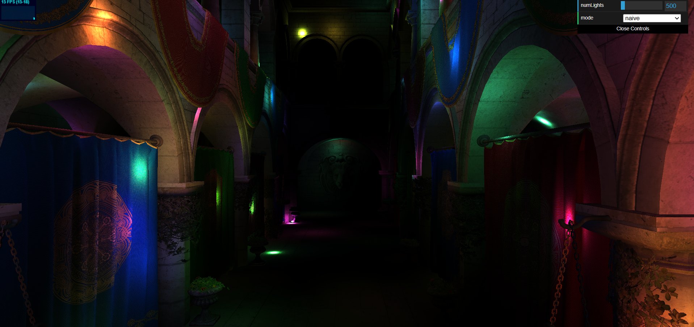
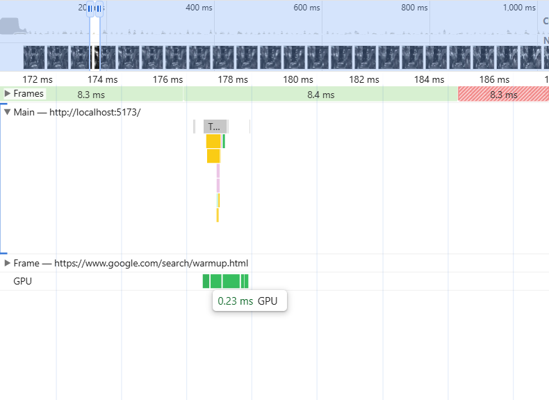
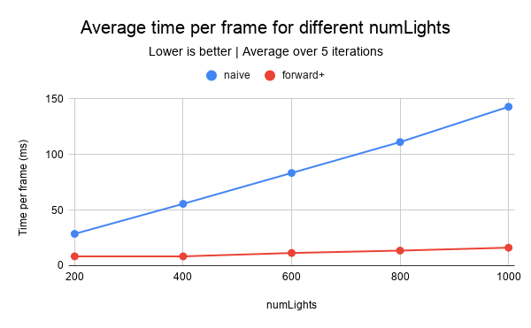
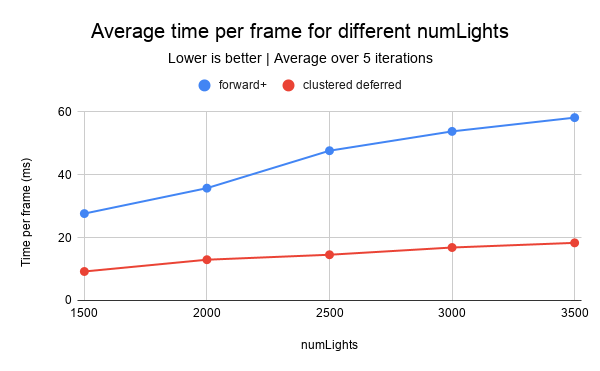
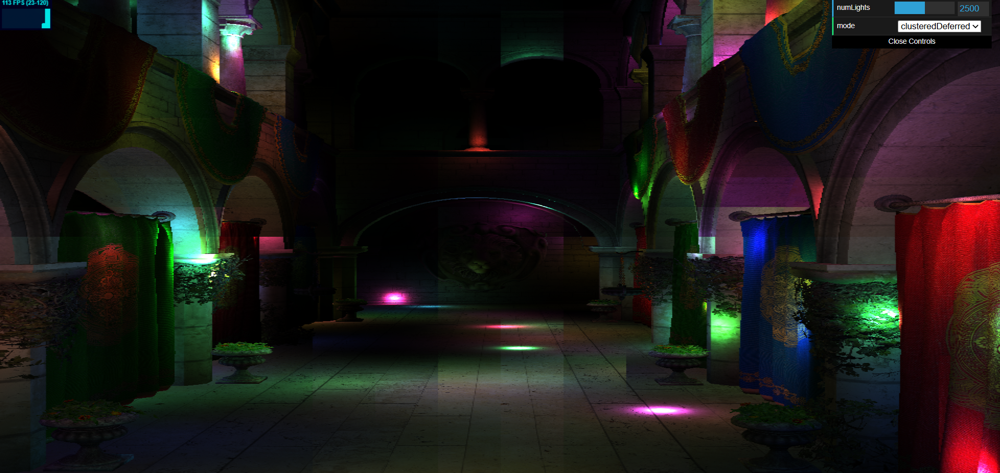
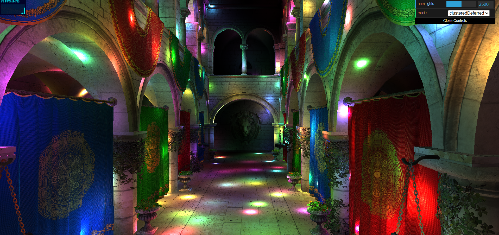
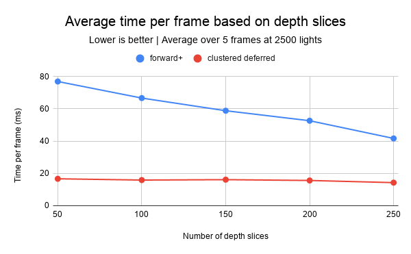

WebGPU Forward+ and Clustered Deferred Shading
======================

**University of Pennsylvania, CIS 565: GPU Programming and Architecture, Project 4**

* Walson Li
* Tested on: Windows 11 Home, i5-10300H @ 2.50GHz, RTX 2060 6GB (Personal Laptop)

### Live Demo

[](https://walsonli.com/Project4-WebGPU-Forward-Plus-and-Clustered-Deferred)

### Demo Video/GIF


### Overview

In this project, I have connected WebGPU bindings and setup logic for a naive shading approach, a forward+ shading approach, and a clustered deferred shading approach. Note that all three shading approaches use a shared vertex positioning shader to convert vertices from model space to the actual location relative to the camera. They also all use a depth test that compares fragments at each pixel and allows overwrites so that only the parts closest to the camera are shown.

#### Naive

In this approach, after vertices are moved to the correct positions and fragments are set up, the naive shader goes to each fragment and illuminates the fragment based on its color and distance from every light. That means that for each fragment, every light in the environment will have to be processed. This is the naive approach because it doesn't account for things like lights that are far away and have no impact.

#### Forward+

In the forward+ approach, instead of iterating through every light in the light set after the vertex positioning shader, there is a clustering step. This step essentially splits 3 dimensional view from the camera into little 3 dimensional tiles, with height, width, and depth. AABBs are set up for each tile, and the distances are then calculated from every light in the environment. Lights that are close enough (within light radius distance) to the clusters are recorded, and passed to the fragment shading step. There, instead of calculating the light effects for every light per fragment, the clustering enables fragments inside the clusters to only be calculated with the set of lights that actually impact it.

The clustering is an extra step, but ideally there are way less clusters than fragments, which causes the fragment shading performance improvement to offset this cost.

The best case scenario for forward+ would be where there are a lot of lights with small light radiuses, and few geometries that cover each other. This is the ideal scenario because clustering would save a lot of lighting cost, and there would be little wasted lighting computations from the depth test.

The worst case scenario would be when all the lights have large light radiuses which strongly impact every fragment, and there is a lot of overlap. The large radiuses mean that the clustering won’t save much, and if cluster_max is set low to save time, lights get dropped and the image gets worse. Meanwhile, the overlap results in a lot of wasted lighting computations.

On top of the clusters, an improvement could be to adjust the `farPlane` value in shaders.ts to actually reflect the farthest plane in the model. The model is way smaller than 1000 meters, so a lot of the clusters aren't actually doing anything.

#### Clustered deferred

The clustered deferred approach adds onto the forward+ approach by moving lighting after the depth test. In the first pass, the depth test is applied on the geometries, and each pixel’s position, normal, and color are saved into GBuffer textures. On the second pass, the cluster lighting is applied once per visible pixel, using a single fullscreen triangle. This way, lighting isn't calculated and wasted like in the naive and forward+ approaches. Deferred does have tradeoffs though, such as the extra memory required for GBuffer texture storage and having 2 passes instead of 1.

The best case for clustered deferred would be a lot of lights with small radiuses and lots of model geometry overlaps. The reasoning for the lights is the same as forward+, and the deferred aspect makes this approach better for high overlap models.

The worst case would be few lights with large radiuses with few overlaps. This would give similar performance to forward+ and naive because all the lights will need to be checked for every fragment anyways.

### Performance analysis

For reference, here are some of the cluster settings I added:

```
cluster_dim1: 16,
cluster_dim2: 16,
cluster_dim3: 256,
cluster_max: 500
```

The cluster dim1/2/3 are the number of clusters in the x, y, and z direction. Cluster_max is the maximum number of lights associated per cluster.

It's also worth noting that the times below are frame time and not GPU time, which can be measured with the Chrome DevTools Performance tab:



I adjusted the lights to maintain under 120 fps in most cases for accurate frame times, otherwise it will stay at 8.3ms (1/120*1000). The only instances it hit 120fps were with forward+ with 200 and 400 numLights for comparisons against the naive approach.

The naive approach was the worst, with most wasted computations. The graph below shows this clearly:



| numLights | 200 | 400 | 600 | 800 | 1000 |
|---|---|---|---|---|---|
| naive | 28.6 | 55.6 | 83.3 | 111.1 | 142.9 |
| forward+ | 8.3 | 8.3 | 11.4 | 13.5 | 16.1 |

This is because in this model, it is wasteful for naive to check every fragment with every light since only a few lights will actually have an impact on each fragment.

Similarly, between forward+ and clustered deferred, clustered deferred showed consistently faster frame time:



| numLights | 1500 | 2000 | 2500 | 3000 | 3500 |
|---|---|---|---|---|---|
| forward+ | 27.6 | 35.7 | 47.6 | 53.8 | 58.1 |
| clustered deferred | 9.2 | 13.0 | 14.5 | 16.8 | 18.3 |

This is most likely because the Sponza map is complex with three different hallways and a lot of surfaces that are covered by other surfaces. This makes the performance boost from clustered deferred significant. However, if there was a simpler scene where there was no overlap, I expect that they would show similar performance. This is because the GBuffer wouldn't actually filter out much, which would cause the lighting step to require similar cost.

One optimization I did was increase the number of depth slices for clustering. Originally, I had 50, but there would be a lot of dark clusters in the output. After changing to 256 depth slices, it reduced how often black clusters appeared:

| 50 depth slices | 256 depth slices |
|:---:|:---:|
|  |  |

From the visuals above, you can see that the tiles from clustering are way more prominent in 50 depth slices than 256 depth slices. Something else that's also clear is that 256 depth slices creates a brighter image with more lights. This is likely because I have the cluster light max set to 500. With 50 depth slices, each slice is very large (20 meters), so each cluster touches more lights. Unfortunately, the clusters are capped at 500 so many lights are getting dropped.

Something also worth noting is the time per frame based on depth slices:



| depth slices | 50 | 100 | 150 | 200 | 250 |
|---|---|---|---|---|---|
| forward+ | 76.9 | 66.7 | 58.8 | 52.6 | 41.7 |
| clustered deferred | 16.7 | 15.9 | 16.1 | 15.6 | 14.3 |

It seems like more slices causes the time per frame to decrease. This is probably because more depth slices means more clusters, and with the constant number of lights (2500), each cluster’s list only holds lights that are actually near it, and less fragments have to calculate unnecessary lights. Compared to clustered deferred, forward+ also gets a much larger performance bonus with more depth slices because it wastes more. Clustered deferred only lights per pixel so there aren't many wasted computations.

### Credits

- [Vite](https://vitejs.dev/)
- [loaders.gl](https://loaders.gl/)
- [dat.GUI](https://github.com/dataarts/dat.gui)
- [stats.js](https://github.com/mrdoob/stats.js)
- [wgpu-matrix](https://github.com/greggman/wgpu-matrix)
